# AnonFit

A privacy-first health and workout companion built as a complete **Identity & Access
Management (IAM)** reference implementation.

AnonFit demonstrates a strict separation between *who you are* and *what your body
does*: identity lives in one collection, health telemetry in another, and the two are
linked only by a permanent `anon_xxxxxxxx` identifier. Administrators get aggregate
wellness trends and account controls — never names, emails, or health histories tied
to a person.

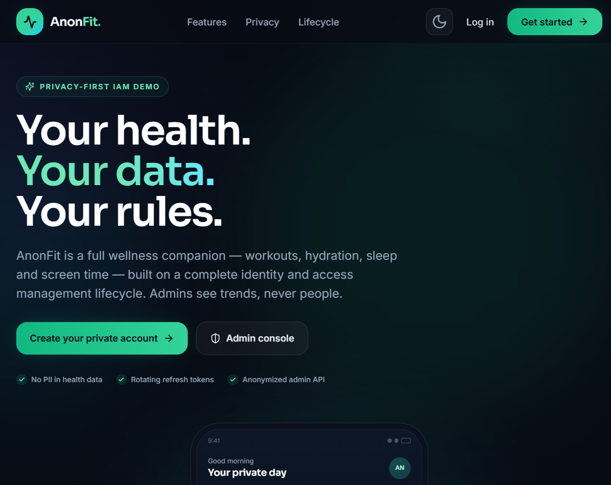

---

## Highlights

### For members
- Email + password registration with a permanent anonymized ID
- JWT access tokens (30 min) with rotating refresh tokens (7 days)
- **Three wrong passwords block the account for 15 minutes** (with an explicit lock message)
- Daily dashboard: workout checklist, hydration, sleep, screen time and streak
- YouTube-based workout plans with timestamped exercises and deep links
- Water tracker with an in-tab hourly reminder
- Self-reported phone stats (screen time, most-used app, sleep) and 14-day history
- Profile security: passkey (fingerprint / face / device PIN) sign-in, password change, privacy lock, session revocation

### For administrators
- Separate admin sign-in and role-gated console
- Anonymized analytics: active users, averages, workout completion, 7-day trends
- Anonymized user directory with 7-day health detail
- Suspend / reactivate / soft-delete accounts with instant session revocation
- Append-only audit trail keyed by anonymized IDs
- **System log console**: browse, filter and search every security/auth/data event, plus a live tail of the raw log file

### Under the hood
- FastAPI + Motor (async MongoDB) + Pydantic v2
- React 18 + Vite + TypeScript + Tailwind CSS + Zustand
- Access/refresh rotation with reuse detection, bcrypt, lockout and status checks
- WebAuthn passkeys (py_webauthn) for passwordless member sign-in and the privacy lock
- Mobile-first UI with dark/light themes and a desktop sidebar

---

## Screenshots

| Member dashboard | Workout detail |
| --- | --- |
| 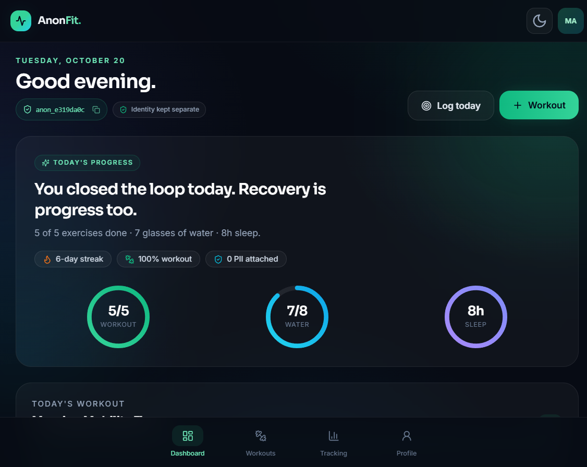 |  |

| Daily tracking | Admin overview |
| --- | --- |
| 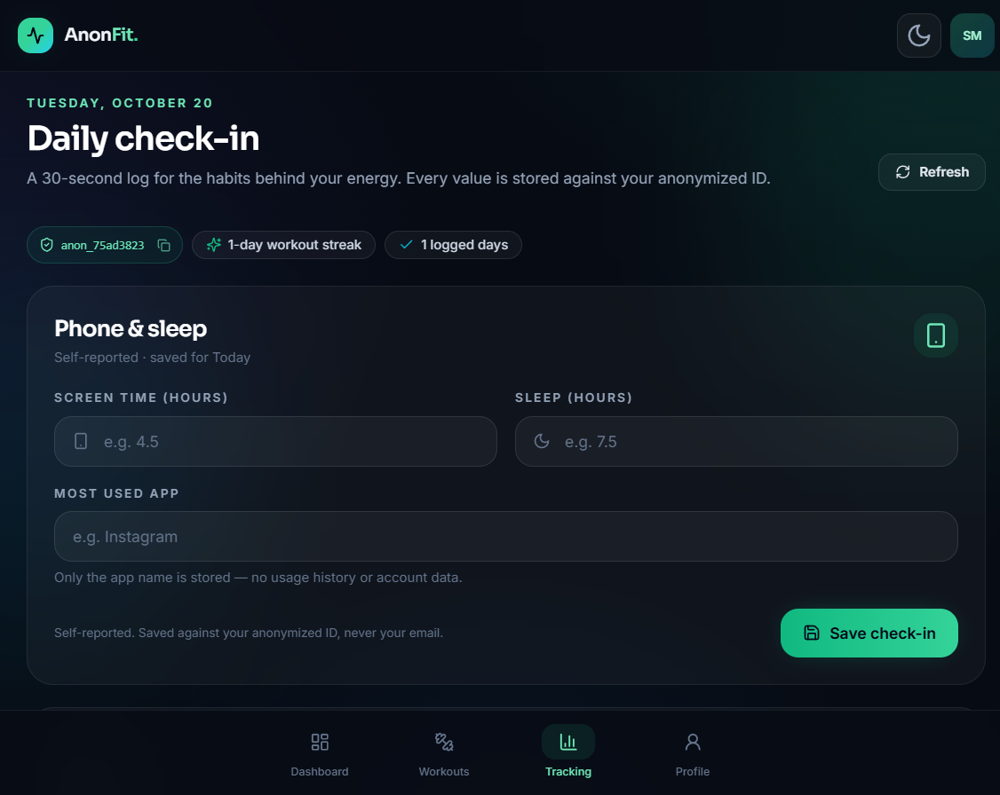 | 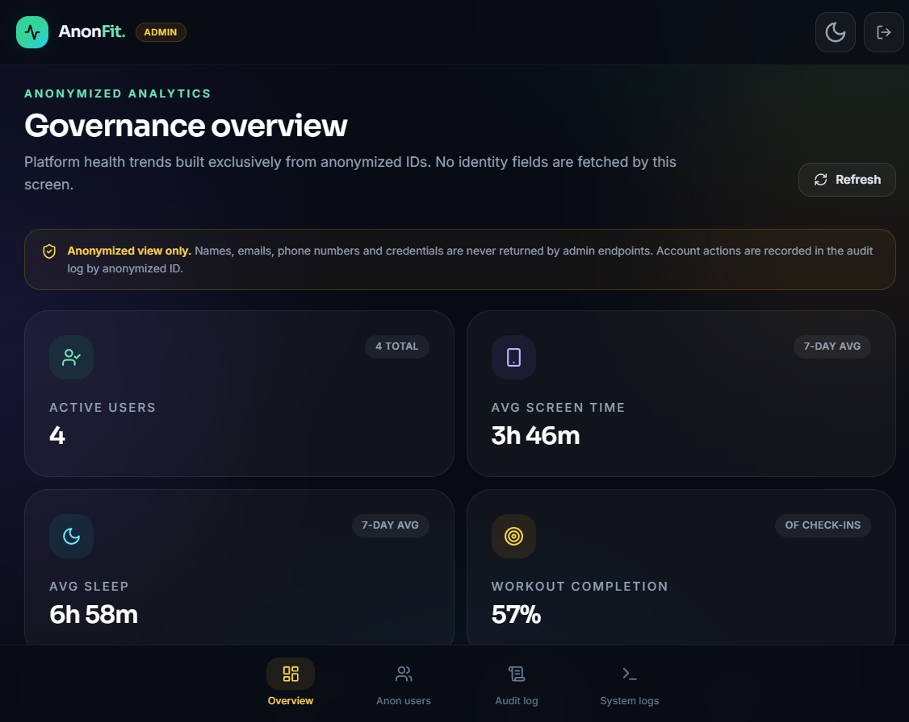 |

| Anonymized directory | Audit trail |
| --- | --- |
| 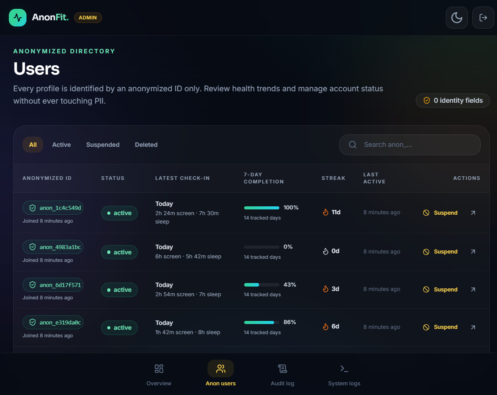 | 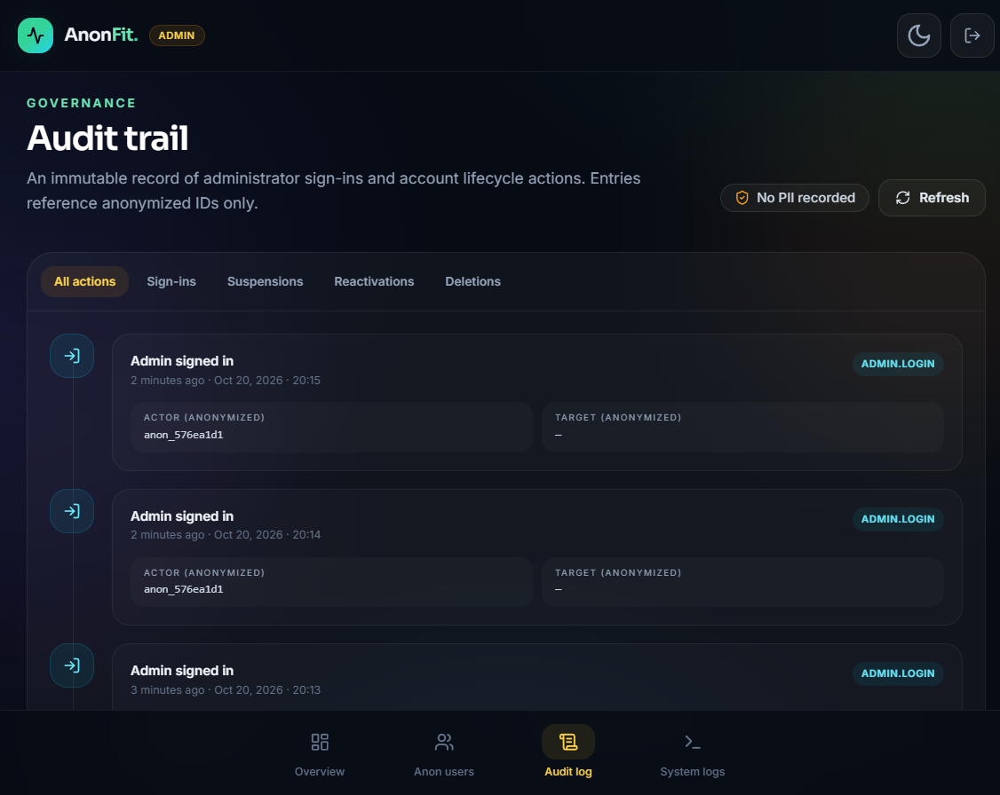 |

| System logs | Raw log file |
| --- | --- |
| 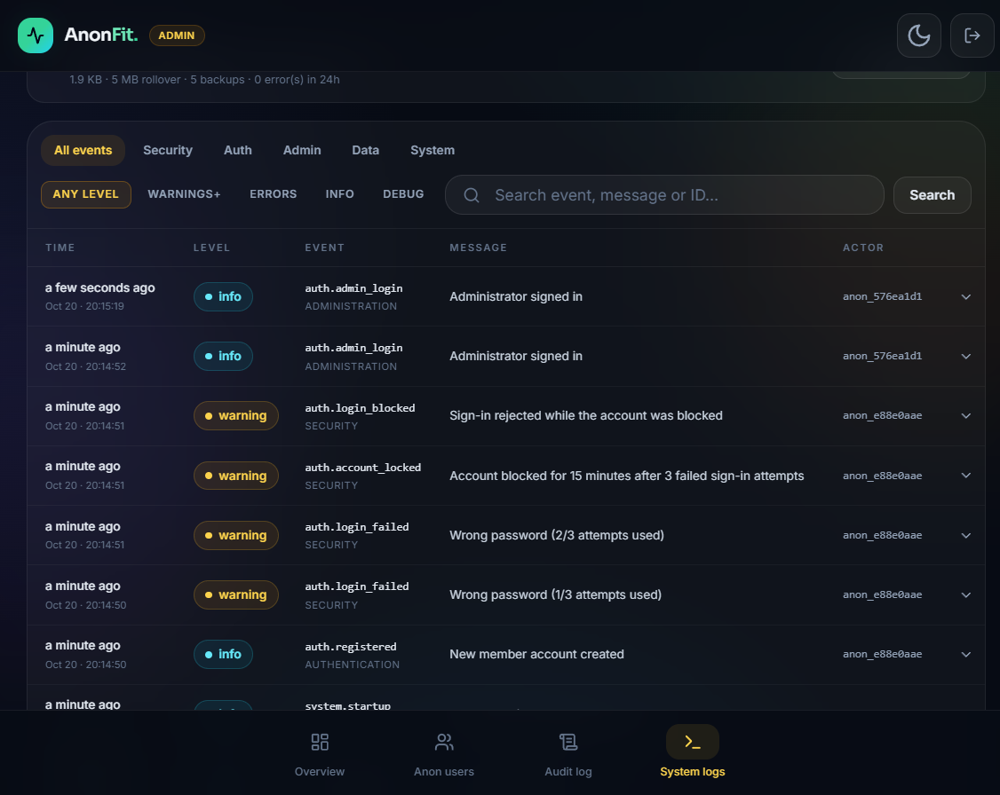 | 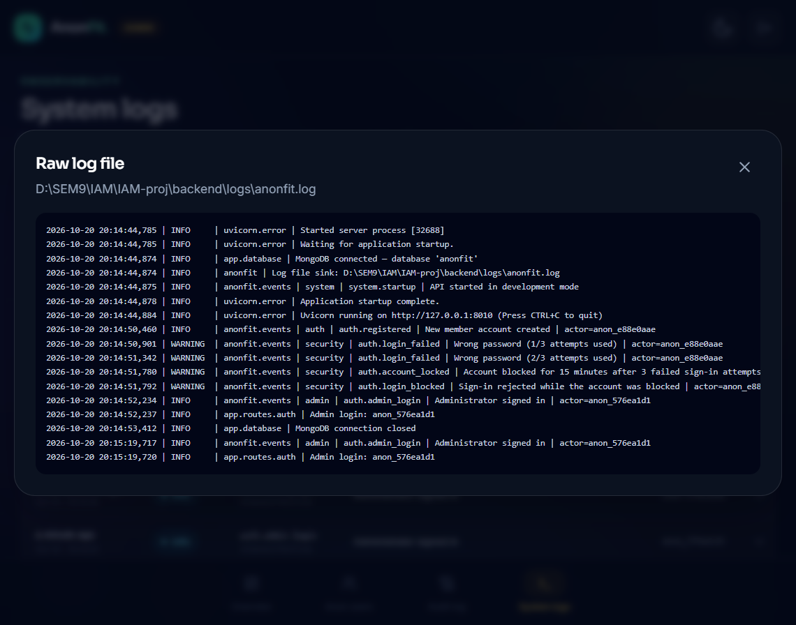 |

| Passkey sign-in | Enrolled devices |
| --- | --- |
| 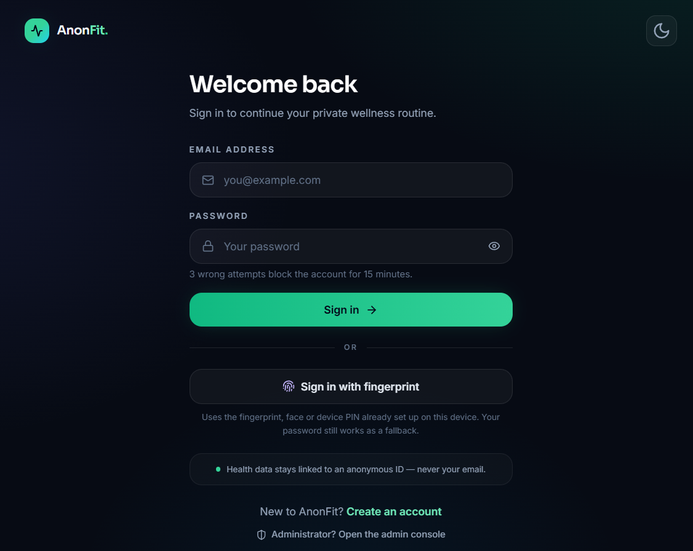 | 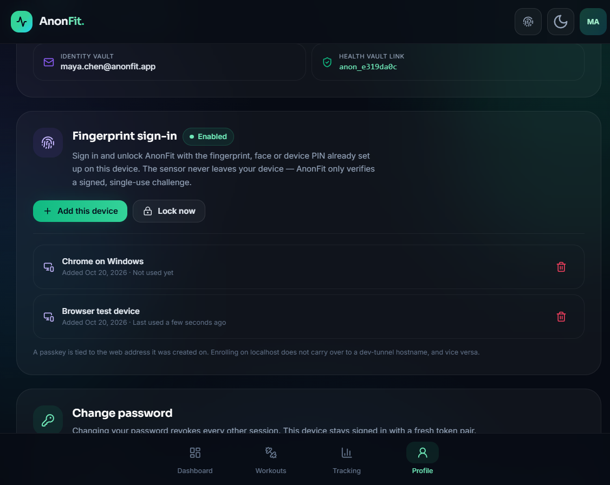 |

> Screenshots are captured from the running app at a tablet/mobile breakpoint. The
> layout expands to a sidebar on desktop.

---

## Architecture

```
┌──────────────────────────────┐        ┌──────────────────────────────┐
│  React SPA (Vite, TS)        │        │  FastAPI                     │
│  Zustand auth + theme        │ HTTPS  │  JWT access / refresh        │
│  Axios refresh interceptor   │ ─────► │  Role + status dependencies  │
└──────────────────────────────┘        └───────────────┬──────────────┘
                                                        │ Motor (async)
                                        ┌───────────────▼──────────────┐
                                        │  MongoDB                     │
                                        │  users        → identity     │
                                        │  health_data  → anon metrics │
                                        │  workout_plans→ anon plans   │
                                        │  refresh_tokens, audit_logs  │
                                        │  webauthn_*   → passkey keys │
                                        │  system_logs  → event table  │
                                        └──────────────────────────────┘
```

Logs are written twice — to `backend/logs/anonfit.log` and to `system_logs` — by a
single `log_event()` call, so the API keeps an on-disk trail even if MongoDB is
unreachable.

### Identity plane vs. health plane

| Collection | Contains | Never contains |
| --- | --- | --- |
| `users` | email, bcrypt hash, role, status, `anonymizedId`, passkey flag | health metrics |
| `health_data` | `anonymizedId`, date, water, screen time, app name, sleep, checklist | email, name, password |
| `workout_plans` | `anonymizedId`, title, YouTube URL, exercises | identity fields |
| `refresh_tokens` | user id, JWT `jti`, expiry, revocation state | health data |
| `audit_logs` | actor/target anonymized IDs, action, metadata | PII |
| `system_logs` | level, category, event, message, anonymized actor, SHA-256 fingerprint | PII, credentials |

Admin responses are built from `users` (anon ID + status only) and `health_data`.
The aggregation code never projects `email` or `passwordHash`, and the UI renders
only anonymized identifiers. Suspension reads the identity record server-side solely
to revoke that user's refresh tokens.

The anonymized ID is generated once at registration and is immutable. Soft-deleting
a user keeps the anonymized health history for analytics while blocking sign-in.

---

## IAM lifecycle

1. **Registration** — email is normalized and validated; password must be at least
   8 characters with a letter and a digit (bcrypt, max 72 bytes). A collision-checked
   `anon_xxxxxxxx` ID is issued.
2. **Sign-in** — generic error messages prevent account enumeration; **three failed
   attempts block the account for 15 minutes**. The first two failures return the same
   `401` as an unknown email, the third returns `429` with a `Retry-After` header, and
   every attempt made during the block is rejected before the password hash is even
   touched. A dummy bcrypt verification runs for unknown emails to reduce timing
   leakage. Each attempt is logged with an anonymized or fingerprinted actor.
3. **Sessions** — access JWT (30 min) and refresh JWT (7 days, `jti`-backed). Every
   refresh rotates the token and atomically revokes the previous one. Reusing a
   rotated token is treated as compromise and revokes the whole token family.
4. **Authorization** — `get_current_user` reloads the user on every request, so
   suspension and deletion take effect immediately even for a live access token.
   Admin routes require `role == "admin"`; admin and user logins are separate
   endpoints, so credentials cannot cross roles.
5. **Account states** — `active` → `suspended` (sessions revoked, login blocked) →
   `active`, or `deleted` (soft delete, login blocked, history retained).
6. **Password change** — verifies the current password, revokes all refresh tokens,
   and issues a fresh pair to the current device.
7. **Passkeys** — members can enroll a platform authenticator and sign in without a
   password; the privacy lock verifies a fresh WebAuthn assertion. See
   [Fingerprint sign-in](#fingerprint-sign-in-passkeys) below.
8. **Audit** — admin sign-ins, suspensions, reactivations and deletions append
   immutable entries with anonymized actor/target IDs and minimal metadata.
9. **Observability** — every authentication, authorization, administrative and data
   event is written to a rotating file and to the `system_logs` table in the cloud
   database; admins can filter and search it in the console, download it as a `.log`
   backup and reset the table.

---

## Logging

### Two sinks, one call

`app/utils/logging_store.py` exposes a single `log_event()` coroutine. Each call writes
to both destinations:

| Sink | Location | Purpose |
| --- | --- | --- |
| Rotating file | `backend/logs/anonfit.log` | 5 MB rollover, 5 backups, app + uvicorn lifecycle output; survives a database outage and can be shipped to any collector. Uvicorn *access* records are excluded so the file never contains client IPs |
| MongoDB table | `system_logs` collection in the **cloud** Atlas cluster (`project.otvpv5q.mongodb.net`) | Indexed by `createdAt`, `level`, `category` and `event`; browsable in the admin console and reset by the **Backup & reset** action |

A logging failure is swallowed and downgraded to a warning so it can never break the
request that produced it.

### Event taxonomy

| Category | Examples |
| --- | --- |
| `security` | `auth.login_failed`, `auth.account_locked`, `auth.login_blocked`, `auth.privilege_denied`, `auth.refresh_reuse`, `auth.password_change_failed`, `auth.passkey_failed`, `auth.passkey_register_failed`, `auth.passkey_unlock_failed` |
| `auth` | `auth.registered`, `auth.login`, `auth.passkey_login`, `auth.passkey_registered`, `auth.passkey_removed`, `auth.passkey_unlocked`, `auth.logout`, `auth.logout_all`, `auth.password_changed` |
| `admin` | `auth.admin_login`, `user.suspend`, `user.reactivate`, `user.soft_delete` |
| `data` | `workout.plan_created`, `workout.plan_deleted`, `workout.completed`, `health.metrics_saved`, `health.water_updated` |
| `system` | `system.startup`, `system.shutdown`, `system.seed_users` |

Levels are `debug`, `info`, `warning`, `error` and `critical`. High-volume bookkeeping
(water glasses, metric saves) is logged at `debug` so the default view stays readable.

### Privacy of the log stream

- Successful events reference the **permanent anonymized ID** only.
- A failed sign-in against an unknown email stores `fp_<12 hex>` — a truncated SHA-256
  of the normalized address — so repeated attacks remain correlatable without turning
  the log into a second identity store. The address itself never reaches the table.
- Passwords, tokens, email addresses and health values are never logged.
- When an account is deleted its log rows remain: the trail is immutable, and it only
  ever contained an anonymized reference.

### Brute-force response

| Attempt | Result |
| --- | --- |
| 1st wrong password | `401 Invalid email or password` (generic) |
| 2nd wrong password | `401 Invalid email or password` (generic) |
| 3rd wrong password | `429` — account blocked for 15 minutes, `Retry-After: 900` |
| Correct password while blocked | `429` — rejected until the block expires |
| After the block expires | Counter reset, three fresh attempts |

### Fingerprint sign-in (passkeys)

Members can replace the password at sign-in with the fingerprint, face unlock or device
PIN already configured on their phone or laptop. This is a real WebAuthn ceremony, not
an animation:

- **Enrollment** — *Profile → Fingerprint sign-in → Enable on this device* asks the
  platform authenticator to create a passkey. The private key stays on the device; the
  API stores only the public key, a signature counter and a label.
- **Sign-in** — *Sign in with fingerprint* on `/login` is **usernameless**: the
  authenticator offers the passkeys it holds for this site, signs a random challenge,
  and the API resolves the account from the credential ID. The endpoint therefore never
  reveals whether an email exists.
- **Privacy lock** — after reopening the app, unlocking requires a *fresh* assertion
  verified by the API (no timer, no simulated scan). *Use password instead* signs out
  and returns to the login page.
- **Password fallback** always works; removing the last passkey clears
  `biometricEnabled`, so the lock stops arming.
- The credential is named with the **anonymized ID**, never the email, so the OS
  passkey picker does not become a second identity store.
- Challenges are random, single-use, scoped to one ceremony (`register` / `login` /
  `unlock`) and expire after five minutes.
- The API asks for `userVerification: required` and a platform authenticator, so the
  sensor or PIN must actually verify the person.

Negative paths are enforced server-side: a tampered signature returns `401`, a replayed
challenge returns `400`, an unlisted origin returns `400`, and an admin token gets
`403` on every passkey route.

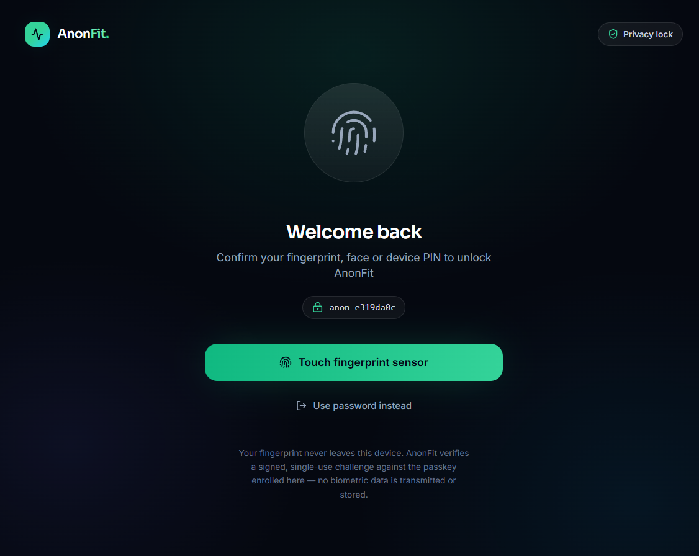

**Configuration** (`backend/.env`)

| Variable | Default | Purpose |
| --- | --- | --- |
| `WEBAUTHN_RP_ID` | *(blank)* | Relying-party ID. Blank derives it from the request `Origin` host, which keeps dev tunnels working when their subdomain changes. Set the registrable domain in production. |
| `WEBAUTHN_RP_NAME` | `AnonFit` | Name shown by the OS passkey prompt. |
| `WEBAUTHN_ORIGINS` | *(blank)* | Extra origins allowed to run a ceremony, on top of `CORS_ORIGINS`. In development, `localhost` and `*.devtunnels.ms` / `*.app.github.dev` / `*.github.dev` are accepted automatically. |

**Two constraints worth knowing**

1. WebAuthn needs a **secure context**: `https://…` or `http://localhost`. A phone
   opening `http://192.168.x.x:5173` cannot use its sensor.
2. A passkey is bound to the **hostname** it was created on (the RP ID). Enrolling on
   `localhost` will not carry over to `https://<id>-5173.devtunnels.ms`, and a new
   tunnel ID means a new hostname. Enroll once per address; the Profile page lists every
   enrolled device so stale ones can be removed.

---

## Tech stack

| Layer | Tools |
| --- | --- |
| Backend | Python 3.11+, FastAPI 0.115, Motor 3.6, Pydantic 2, python-jose, passlib/bcrypt, py_webauthn 3 |
| Database | MongoDB Atlas (cloud, `project.otvpv5q.mongodb.net`) — or MongoDB 7 locally; indexes created on startup, TTL on refresh tokens and challenges |
| Frontend | React 18, Vite 6, TypeScript 5.7, Tailwind CSS 3.4, Zustand 5, React Router 6, Axios, lucide-react, react-hot-toast, dayjs, @simplewebauthn/browser |
| Tooling | npm, pip/venv, optional Docker for a local MongoDB |

---

## Project structure

```
IAM-proj/
├── backend/
│   ├── app/
│   │   ├── auth/          # JWT, password hashing, dependencies, sessions
│   │   ├── models/        # MongoDB document shapes
│   │   ├── routes/        # auth, users, health, admin, webauthn
│   │   ├── schemas/       # Pydantic camelCase request/response models
│   │   ├── utils/         # audit, dates, ids, logging_store, seeding, serializers
│   │   ├── config.py
│   │   ├── database.py
│   │   └── main.py
│   ├── logs/              # anonfit.log (+ rotations) — created at runtime
│   ├── .env.example
│   └── requirements.txt
├── frontend/
│   ├── src/
│   │   ├── api/           # Axios client + typed endpoints
│   │   ├── components/    # UI primitives, layout, feature components
│   │   ├── context/       # session bootstrap
│   │   ├── pages/         # member + admin screens
│   │   ├── stores/        # Zustand auth/theme
│   │   ├── types/
│   │   └── lib/           # utils, WebAuthn helpers
│   ├── .env.example
│   └── package.json
├── docs/screenshots/
└── README.md
```

---

## Getting started

### 0. Prerequisites

- Python **3.11+**
- Node.js **18+** and npm
- A **MongoDB Atlas** cluster (cloud) — `backend/.env` already points at
  `mongodb+srv://…project.otvpv5q.mongodb.net/`. Allow your IP under
  **Atlas → Network Access** (use `0.0.0.0/0` for a quick demo).

Prefer a local database? Set `MONGODB_URL=mongodb://localhost:27017` in
`backend/.env`, or start one with Docker:

```bash
docker run -d --name anonfit-mongo -p 27017:27017 mongo:7
```

### 1. Backend

```bash
cd backend

python -m venv .venv

# Windows (PowerShell)
.\.venv\Scripts\Activate.ps1
# macOS / Linux
# source .venv/bin/activate

pip install -r requirements.txt

# Create your local environment file
copy .env.example .env        # Windows
# cp .env.example .env        # macOS / Linux
```

Edit `backend/.env` and **replace `JWT_SECRET`** with a long random value:

```bash
python -c "import secrets; print(secrets.token_urlsafe(48))"
```

Run the API:

```bash
uvicorn app.main:app --reload --port 8010
```

- API: <http://localhost:8010/api>
- Swagger UI: <http://localhost:8010/docs>
- Health check: <http://localhost:8010/api/health>

### 2. Seed the first administrator

Admin accounts are never created through the public registration endpoint. Use the
seed script from `backend/`:

```bash
python -m app.utils.seed_admin
```

It prompts for a password (or reads `SEED_ADMIN_EMAIL` / `SEED_ADMIN_PASSWORD` from the
environment). Running it again for an existing admin resets the password and unlocks
the account. For a non-interactive local setup:

```powershell
$env:SEED_ADMIN_EMAIL="admin@anonfit.app"
$env:SEED_ADMIN_PASSWORD="ChangeMe123!"
python -m app.utils.seed_admin
```

Then sign in at `/admin/login` — **not** at the regular user login.

> Never ship a seeded password. Choose a unique value and change it after the first
> sign-in. Environment variables override the values in `.env`.

### 3. Seed four demo members (optional)

The admin console is much more interesting with data in it. This creates four regular
users, each with a YouTube plan and 14 days of wellness history:

```bash
python -m app.utils.seed_users
```

| Email | Password | Profile |
| --- | --- | --- |
| `maya.chen@anonfit.app` | `UserPass123` | Consistent streak, balanced screen time |
| `liam.ortiz@anonfit.app` | `UserPass123` | Moderate activity, average sleep |
| `sofia.haddad@anonfit.app` | `UserPass123` | Low activity, high screen time |
| `noah.weber@anonfit.app` | `UserPass123` | Long streak, high completion |

Re-running the script resets these four accounts and their demo history (use
`--keep-data` to keep health history). No other account is touched. Change the
passwords if the demo is exposed beyond your machine.

### 4. Frontend

```bash
cd frontend
npm install
copy .env.example .env        # Windows
# cp .env.example .env        # macOS / Linux
npm run dev
```

Open <http://localhost:5173>.

The browser never talks to the API directly. It calls the relative path `/api`, and the
Vite dev server proxies those requests to `http://127.0.0.1:8010` (see
`frontend/vite.config.ts`). That keeps the app same-origin — no CORS preflight, no mixed
content — and means **a single forwarded port is enough** in a remote IDE. The API port
is set explicitly in the backend command above to avoid clashing with common local
services; if you move the backend, set `VITE_API_PROXY_TARGET` and restart Vite.

Production build:

```bash
npm run build     # tsc --noEmit && vite build
npm run preview   # serves dist/ with the same /api proxy
```

### 5. Remote IDE / forwarded port

Running this in VS Code remote, a dev container or a cloud workspace? Forward **only
port 5173** and open the forwarded URL (for example
`https://<id>-5173.devtunnels.ms/`).

- Keep the frontend on the default relative base (`VITE_API_URL=/api`, or leave it
  unset). Do **not** point it at `http://127.0.0.1:8010` — that address is resolved by
  the viewer's browser and will fail from anywhere but the host machine.
- `vite.config.ts` allows `.devtunnels.ms`, `.app.github.dev` and `.github.dev` host
  names. Add your own tunnel domain to `server.allowedHosts` if it differs.
- The backend stays bound to `127.0.0.1`, so it is not exposed; the proxy is the only
  bridge.
- Restart Vite after changing any `VITE_*` value — those are inlined when the dev
  server starts, so reloading the page is not enough.
- Forwarding 5173 exposes **all** API routes, including the admin console, to anyone
  with the URL. Change `AdminPass123` and the demo passwords first.
- Swagger (`/docs`) is not proxied. Forward 8010 separately if you need it.

---

## API overview

| Method | Path | Purpose |
| --- | --- | --- |
| `POST` | `/api/auth/register` | Create a user, issue tokens + anon ID |
| `POST` | `/api/auth/login` | User sign-in |
| `POST` | `/api/auth/admin/login` | Admin sign-in (role-gated) |
| `POST` | `/api/auth/refresh` | Rotate refresh token |
| `POST` | `/api/auth/logout` | Revoke one refresh token |
| `POST` | `/api/auth/logout-all` | Revoke all sessions |
| `GET` | `/api/users/me` | Current profile |
| `POST` | `/api/users/me/change-password` | Change password + rotate session |
| `POST` | `/api/auth/webauthn/register/begin` | Start passkey enrollment (members) |
| `POST` | `/api/auth/webauthn/register/finish` | Verify attestation, store the public key |
| `POST` | `/api/auth/webauthn/login/begin` | Start usernameless sign-in |
| `POST` | `/api/auth/webauthn/login/finish` | Verify assertion, issue tokens |
| `POST` | `/api/auth/webauthn/unlock/begin` | Start privacy-lock unlock |
| `POST` | `/api/auth/webauthn/unlock/finish` | Verify assertion without issuing tokens |
| `GET` | `/api/auth/webauthn/credentials` | List enrolled devices |
| `DELETE` | `/api/auth/webauthn/credentials/{id}` | Remove an enrolled device |
| `GET` | `/api/health/today` | Dashboard aggregate |
| `PATCH` | `/api/health/water` | Set water glasses |
| `PATCH` | `/api/health/metrics` | Screen time / app / sleep |
| `GET` | `/api/health/history?days=14` | Daily history + streak |
| `POST` | `/api/health/plans` | Create a YouTube workout plan |
| `GET` | `/api/health/plans` | List plans |
| `GET` | `/api/health/plans/{id}` | Plan detail |
| `DELETE` | `/api/health/plans/{id}` | Delete plan |
| `POST` | `/api/health/plans/{id}/exercises/{i}/toggle` | Check exercise |
| `GET` | `/api/admin/stats` | Anonymized platform analytics |
| `GET` | `/api/admin/users` | Anonymized directory (filter/search/page) |
| `GET` | `/api/admin/users/{anonId}` | Anonymized 7-day detail |
| `PATCH` | `/api/admin/users/{anonId}/status` | Suspend / reactivate |
| `DELETE` | `/api/admin/users/{anonId}` | Soft delete |
| `GET` | `/api/admin/audit-logs` | Audit trail (filter by action) |
| `GET` | `/api/admin/logs` | System log table (page, level, category, search) |
| `GET` | `/api/admin/logs/stats` | Volume summary + log-file path/size |
| `GET` | `/api/admin/logs/file?lines=200` | Tail the raw rotating log file |
| `POST` | `/api/admin/logs/backup` | Download every `system_logs` row as a `.log` file, then purge the exported rows so a new log window starts |

All request/response bodies use **camelCase** (Pydantic aliases); timestamps are ISO
8601 UTC.

---

## Data & privacy guarantees

- Health queries are scoped by `current_user["anonymizedId"]` — no health endpoint
  reads an email.
- `health_data` documents are unique per `(anonymizedId, date)`.
- Refresh tokens store no email; they reference the internal user id and are removed
  automatically by a TTL index after expiry.
- Admin stats aggregate over the last 7 days of `health_data`, computing streaks and
  completion rates server-side.
- Admin user search accepts an anonymized ID fragment only.
- Audit metadata is limited to lifecycle context (such as the previous status) —
  never credentials, contact details or network addresses.
- The frontend never requests or renders another user's identity fields in the admin
  console.
- `system_logs` stores anonymized IDs or a truncated SHA-256 fingerprint — never the
  email, password or token that caused the event.

---

## Verification

The backend was exercised end-to-end against MongoDB 7 with **80 passing checks**:
registration, duplicate email, water/metrics validation, 14-day
history, YouTube parsing, plan creation, exercise toggles and streak, refresh
rotation and reuse detection, password change, role separation, statistics,
anonymized directory/detail, suspension/reactivation, audit filtering, soft delete,
and direct database assertions that `health_data` / `workout_plans` / `audit_logs`
contain no identity fields.

A second suite covers the logging layer and the lockout policy — **15/15 checks**:
attempts 1–2 return `401`, attempt 3 returns `429` and writes `auth.account_locked`,
a correct password is still refused while blocked, the log table filters by category
and search, `auth.login_*` entries contain no email address, the stats endpoint
reports the file size, and the raw file tail returns real lines.

A third suite drives the WebAuthn ceremonies with a **software authenticator** — a real
EC P-256 key, a real CBOR attestation object and real ECDSA assertions — **34/34
checks**: enrollment, usernameless sign-in, app-lock unlock, single-use challenges,
tampered signatures, foreign origins, admin rejection, device listing/removal, and log
hygiene (neither the email nor the credential ID appears in the log file).

The passkey UI was then exercised in the browser with the same key: sign-in from
`/login`, enrollment from the Profile page, and a fresh assertion releasing the privacy
lock.

The frontend passes a strict production build (`tsc --noEmit && vite build`) and was
smoke-tested in a browser: registration, session bootstrap, workout creation and
checklist, metric saving, sign-out, admin login, directory, audit log and the system
log console.

---

## Design notes & limitations

- **Phone stats are self-reported.** A web app cannot read native screen-time or app
  usage data, so the member enters them manually; only the app *name* is stored.
- **Passkeys are real, with two web constraints.** The fingerprint is read by the
  browser's platform authenticator and never reaches AnonFit — the server verifies a
  signature. WebAuthn requires a secure context (`https://` or `localhost`) and binds a
  credential to the hostname (RP ID), so a passkey enrolled on `localhost` does not work
  through a tunnel hostname, and vice versa.
- **Water reminders** run only while the browser tab is open (in-app nudge), avoiding
  notification permissions and third-party push services.
- **Log retention is admin-driven.** `system_logs` intentionally has no TTL index;
  instead the admin presses **Backup & reset** in the console: the whole table is
  written to a downloadable `.log` file, those rows are purged, and logging restarts
  from an empty table (the backup itself is logged as the first event of the new
  window). The file sink keeps its own rolling 5 × 5 MB history independently, so a
  copy survives even if a download is lost.
- **YouTube** is embedded via `youtube-nocookie.com`; exercise timestamps open
  privacy-enhanced links in a new tab. No watch history is collected.
- The app is designed for a local/demo deployment. For production, add HTTPS, a
  secrets manager, rate limiting at the edge, email verification, and CSRF strategy
  if cookies replace bearer tokens.

---

## Troubleshooting

| Symptom | Fix |
| --- | --- |
| `Could not connect to MongoDB` | Check `MONGODB_URL` in `backend/.env` (Atlas user, password and cluster must match) and that your IP is allowed in **Atlas → Network Access**; for a local DB, start MongoDB or Docker |
| Frontend shows “Cannot reach the AnonFit API” | Start the backend, then check `http://localhost:5173/api/health` — it should return `{"status":"ok"}`. If the app is open on a forwarded URL, `VITE_API_URL` is probably still an absolute `http://127.0.0.1:8010/api`; set it back to `/api` and restart Vite |
| “Blocked request. This host is not allowed.” | Add your tunnel domain to `server.allowedHosts` in `frontend/vite.config.ts` |
| CORS error | Add the frontend origin to `CORS_ORIGINS` and restart the API |
| No “Sign in with fingerprint” button | The device exposes no platform authenticator, or the page is not a secure context. Use `https://` or `http://localhost` on a phone or laptop with a fingerprint, face unlock or PIN |
| “Fingerprint check was cancelled…” repeatedly | Nothing is enrolled for this site on this device, or the OS prompt was dismissed. Sign in with your password, then enroll from *Profile → Fingerprint sign-in* |
| Passkey works on localhost but not on the tunnel URL | Credentials are bound to the hostname (RP ID). Enroll again on the tunnel hostname; `WEBAUTHN_RP_ID` is derived from the request origin unless you set it explicitly |
| Passkey sign-in returns “This sign-in attempt expired” | The five-minute challenge window elapsed (often a stale tab). Reload the page and try again |
| `JWT_SECRET must be at least 32 characters` | Generate a longer secret in `backend/.env` |
| Admin login says “does not have administrator access” | Use `/admin/login`; seed an admin with the script |
| “Too many failed attempts… blocked” | Wait for the 15-minute window, or reactivate the account from the admin console (reactivation clears the counter) |
| Port already in use | `uvicorn app.main:app --port 8011` and set `VITE_API_PROXY_TARGET=http://127.0.0.1:8011` before starting Vite |

---

Built as a Semester 9 IAM project. Health data should belong to the person who
generated it — AnonFit shows one way to keep it that way.
